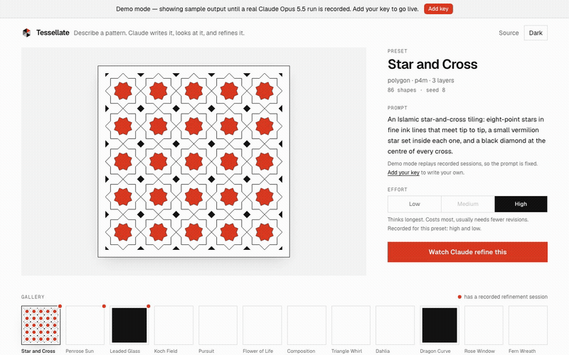
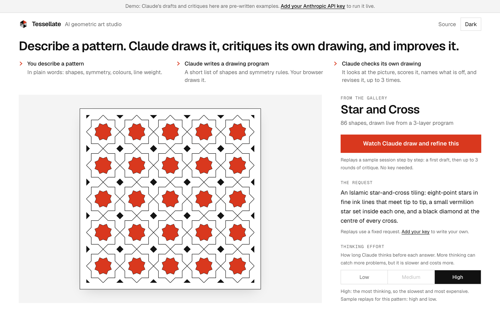
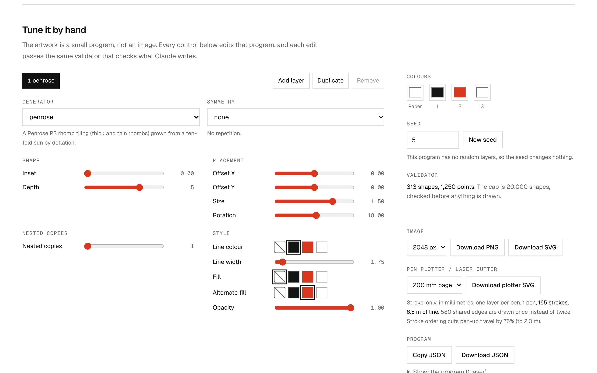
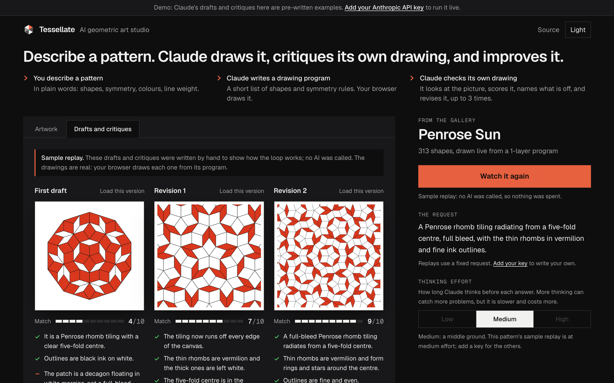
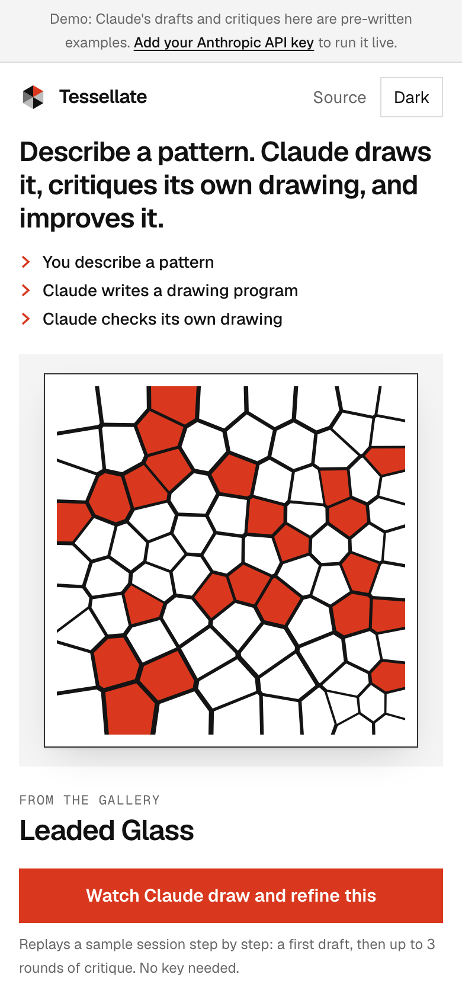
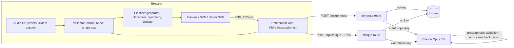

# Tessellate

Describe a pattern in words, and Claude turns it into geometric art: it writes the pattern as a small drawing program, looks at the picture it made, critiques it, and improves it.

[](https://github.com/davezagin-max/tessellate/actions/workflows/ci.yml)
[](LICENSE)
[](#run-locally)


*One click on the first screen replays a session. Each column is one drawing with its match score: the first draft scores 4/10 (the stars float apart, and there are no black diamonds); two rounds of critique and revision later, it scores 9/10. This replay is a hand-written sample (see below); the drawings are real.*

## What it does

- **Turns a sentence into a drawing.** You describe a pattern, for example "eight-point stars in fine ink lines that meet tip to tip". Claude writes it as a short drawing program (shapes, symmetry, colours), and your browser draws it as crisp vector art.
- **Checks its own work.** The app turns each drawing into a picture and shows it to Claude next to the original request. Claude scores how well it matches, lists what is off, and revises the program, up to three times.
- **Lets you take over.** Twelve ready-made patterns, sliders for the numbers in the program, and downloads as PNG or as an SVG file a pen plotter or laser cutter can follow.
- **Keeps the AI on a leash.** Code checks every program before it is drawn and caps its size, so nothing Claude (or you) writes can freeze the page. The list of what changed between drafts is computed by code, not taken from Claude's words.

No API key existed while this was built, so the Claude sessions in the demo are hand-written examples, and the app labels them "sample" wherever they appear. The drawings in a replay are real: your browser draws each one from its program. Demo data in this commit is hand-written sample output; `pnpm record` replaces it with real Claude Opus 5.5 runs.

## Try it

The live demo is coming soon. Until then, this is the one-click tour: a pattern is already drawn, and **Watch Claude draw and refine this** replays a session step by step, with a status line saying what is happening.



To run it yourself with no key (details in [Run locally](#run-locally)):

```bash
pnpm install
pnpm dev
```

Then pick any of the 12 patterns in the gallery, drag a slider, or download a plotter-ready SVG. Add your own Anthropic API key in the app (the "Add your Anthropic API key" link at the top) to write your own request and run it live.

| First screen | Tune by hand | Dark | Phone |
| --- | --- | --- | --- |
|  |  |  |  |

## Why it's interesting

- **The model writes a program, and code decides whether to draw it.** Structured outputs reject recursive schemas and numeric bounds, so the language is flat: a program is a seed, a palette, and up to 8 layers of 27 required fields. One table (`PARAMS` in `lib/geometry/dsl.ts`) holds every range, and three things are generated from it: the validator's clamps, the slider panel, and the language reference in the system prompt. The model is never told a limit the code does not enforce.
- **Symmetry is exact group theory, not hand-placed copies.** All 17 wallpaper groups are defined by two or three crystallographic generators and closed under composition in integer arithmetic (lattice coordinates, translations in halves), so closure needs no floating-point tolerance. Tests check each group's order, closure, inverses, that every map is an isometry, that mirrors are told apart from glides (p4g has exactly 2 of each), and that a finished render really maps onto itself under every map of its group.
- **No program can freeze the tab.** Before any geometry is built, the validator computes an upper bound on the finished artwork (motif size times the symmetric copies that can reach the canvas) and rejects anything over 20,000 shapes or 200,000 points with a message that names the cheapest fix. A fuzz test asserts the bound is never below what the renderer actually produces. When Claude's program is rejected, those same messages go back to it for one self-correction pass.

Also worth a look: the plotter exporter (`lib/geometry/plotter.ts`) is its own pipeline, not "SVG with fills off". It clips to the page, draws shared edges once, chains segments into long strokes, and orders them to cut pen-up travel. For the Penrose preset on a 200 mm page that means 313 tiles become 165 strokes, 580 shared edges are drawn once, and ordering cuts pen-up travel by 76%.

## Architecture



The pipeline is pure and seeded (mulberry32, no `Math.random`): the same program always produces byte-identical SVG, which a snapshot test pins for all 12 presets. Canvas, SVG, and the plotter export all read the same scene, so they cannot disagree about what the artwork is.

A layer in the language looks like this (fields the layer does not read are left out here; on the wire every field is present):

```json
{
  "generator": "polygon", "symmetry": "p4m", "cell": 0.4,
  "sides": 8, "inset": 0.2346, "size": 0.5,
  "stroke": 0, "strokeWidth": 2.5, "fill": -1
}
```

Generators: `polygon` (also stars, circles, lines), `lsystem`, `voronoi`, `penrose` (P3 rhombs by deflating Robinson triangles), `subdivision`. Symmetry: `none`, `radial` (cyclic or dihedral), or any of the 17 wallpaper groups.

## How it uses Claude Opus 5.5

| Feature | Why |
| --- | --- |
| Structured outputs for the program and for the review | The answer is parsed straight into the language's schema. The schema carries no bounds (the API rejects them), so a deterministic validator clamps and checks after parsing. |
| Vision on its own output | Writing geometry blind is hard: stars that should touch float apart, the wrong tile gets the colour. The browser renders each program to a 1024 px PNG and sends it back with the original prompt, so the review is of what was actually drawn. |
| An iterative loop, stateless per step | Draft, then up to three reviews, each returning `{ matches, gaps, score, done, revisedProgram }`. Every call is a fresh conversation with the prompt, the current program, and its image, so there is no long history to replay and any step can be recorded or replayed alone. Stop rules are code: `done`, an unchanged revision, or the limit. |
| Effort control | A low / medium / high selector, explained in plain words in the UI, is passed explicitly on every call; the cost line under the run button shows what each run cost, in dollars and tokens, so a visitor can see effort trade thinking for cost. |
| One self-correction pass | If a well-formed answer fails validation, the validator's messages are appended as the next user turn (the first turn, thinking blocks included, is sent back untouched) and Claude gets one retry. |
| Prompt caching | The language reference is generated from the parameter table and is identical on every call, so the system prompt is sent with a cache breakpoint. |
| Untrusted input and refusals | The visitor's prompt and the program under review are wrapped in tags the system prompt declares to be data. A refusal is returned as a normal result and shown as a clear message with what was spent so far. |

Code computes the facts; the model reasons and explains. Shape counts, plot statistics, and the "changes to the program" list under each revision are computed (the last one is a diff of the two programs), never taken from the model's prose. The match score is the model's own judgement, a structured field shown as returned.

**Your key stays yours.** The app is bring-your-own-key. The key lives in your browser tab's memory (optionally `sessionStorage`), travels in an `x-anthropic-key` header to this app's own API route, and is used for that one request. The server never stores or logs it. Each live action shows its token count and cost.

## Run locally

```bash
pnpm install
pnpm dev
```

Open http://localhost:3000. It runs in demo mode until you add a key in the UI.

To replace the sample sessions with real ones, put `ANTHROPIC_API_KEY` in `.env.local` and run `pnpm record` (it drives the real page in headless Chromium and stops at a $3 budget by default), then `pnpm test`.

## Tests & quality

```bash
pnpm check   # lint, typecheck, unit tests, production build
```

296 tests, about one second. What they cover:

- **Symmetry maths:** the order and point-group order of all 17 groups, closure, inverses, isometry for three cell shapes, orbit size of a generic point, mirror versus glide, p3m1 versus p31m, and an end-to-end check that a rendered scene is invariant under its own group.
- **Language validation:** clamps and warnings, structural errors, L-system grammar errors, idempotence, and a fuzz over random in-range programs showing the shape-cap estimate is a true upper bound.
- **Renderer determinism:** a hash snapshot of the SVG for every preset, plus a check that the Canvas painter issues the same paths in the same order as the SVG writer.
- **Generators:** Penrose (triangle-count recurrence, area conservation, rhomb angles and edge lengths, thick-to-thin ratio near the golden ratio, edge-to-edge), Voronoi (cells partition the square, every sample point falls in its nearest site's cell), L-systems, subdivision.
- **Plotter export:** clipping, shared-edge removal, chaining (the dragon curve stays one stroke), ordering, real lengths.
- **Claude path, with a fake client:** request shape and effort, wire schemas free of unsupported keywords, self-correction, refusal, truncation, image handling.
- **Smoke test:** the real refinement loop against the real route handlers in demo mode, with no browser and no key. Every fixture is validated through the same pipeline the live path uses.

CI runs the same checks plus a gitleaks secret scan on every push.

## Tradeoffs, limitations, next steps

- **The live path has not yet run against the real API.** No key existed while this was built. It is complete and covered by fake-client tests and by a browser run with every API call intercepted, but the first real run is where I expect surprises: whether the API accepts the 27-field layer schema as is, and how good a first draft is when the model places motifs without seeing them.
- **The demo sessions are hand-written samples** until `pnpm record` is run with a key. The UI says so wherever they appear, and the low-effort sample is not evidence of how low effort behaves.
- **The shape-cap estimate is conservative for wallpaper layers.** It bounds a motif by a disc, so it can reject a program that would have fit after culling. The error says what to change.
- **Lattices are axis-aligned.** p1 and p2 use a rectangular cell, not a general oblique one, and there is no lattice rotation parameter. Motifs are not clipped to the fundamental domain: a motif that crosses a mirror overlaps its image.
- **Curves are polylines** (a circle is a 64-gon), which is what a plotter wants anyway.
- **Plotter export** outlines a shape in its stroke colour (or its fill colour if it has no stroke), drops fills and opacity, and orders strokes greedily rather than optimally.
- **Rendering runs on the main thread.** The cap bounds the worst case (in a 6,000-program fuzz run during review, the slowest accepted program built in about 130 ms), so I left out a Web Worker.
- Three effort levels are offered; `xhigh` and `max` are left out. Each step is one request, so there is no streamed progress text during a live call.
- Rate limiting is in memory per server instance: enough to blunt abuse of a demo, not a global quota.

Next: record real sessions and compare efforts with measured cost and scores, hatch fills for the plotter, oblique lattices, and a "review what is on my canvas now" action that starts the loop from a hand-edited program.

---

Built with Claude Code and Claude Opus 5.5.
