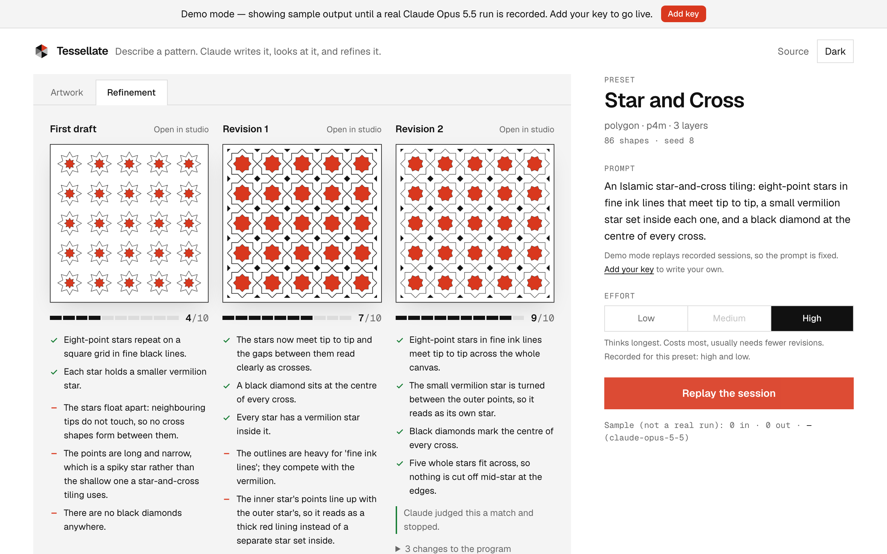
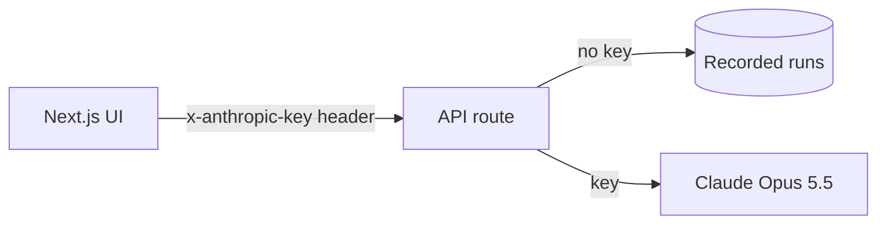

# {{NAME}}

> {{ONE_LINE_PITCH}}

[](https://github.com/davezagin-max/{{REPO}}/actions/workflows/ci.yml)
[](LICENSE)
[]({{LIVE_URL}})



## Try it in 10 seconds

**[Open the live demo]({{LIVE_URL}})**: no key, no sign-up. {{WHAT_TO_CLICK_FIRST}}

Demo mode replays recorded Claude Opus 5.5 runs. Add your own Anthropic key in the app to run it live.

## Why it's interesting

- **{{DECISION_1}}** {{WHY_1}}
- **{{DECISION_2}}** {{WHY_2}}
- **{{DECISION_3}}** {{WHY_3}}

## Architecture



## How it uses Claude Opus 5.5

| Feature | Why |
| --- | --- |
| {{FEATURE}} | {{WHY}} |

**Your key stays yours.** The app is bring-your-own-key. The key lives in your browser tab's memory (optionally `sessionStorage`), travels in an `x-anthropic-key` header to this app's own API route, and is used for that one request. The server never stores or logs it. Each live action shows its token count and cost.

## Run locally

```bash
pnpm install
pnpm dev
```

Open http://localhost:3000. It runs in demo mode until you add a key in the UI.

## Tests & quality

```bash
pnpm check   # lint, typecheck, unit tests, production build
```

{{WHAT_THE_TESTS_COVER}}

CI runs the same checks plus a gitleaks secret scan on every push.

## Tradeoffs, limitations, next steps

- {{TRADEOFF}}
- Rate limiting is in memory per server instance: enough to blunt abuse of a demo, not a global quota.

---

Built with Claude Code and Claude Opus 5.5.
